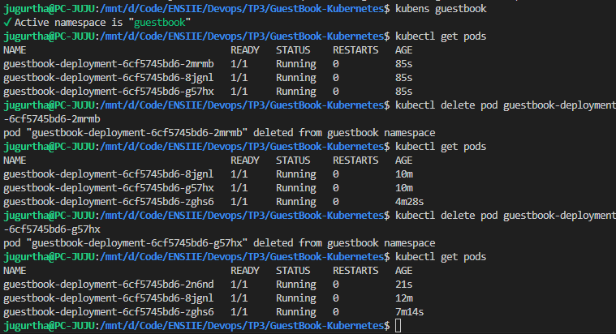
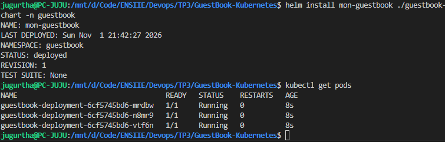

# GuestBook Kubernetes

## Préparer votre environnement

Vérifier si on possède tous les outils nécessaires pour le TP.

### Problème rencontré et pourquoi il est survenu
L'installation de Helm fut brièvement problèmatique car les autres outils était déjà installés.

### Solution appliquée et pourquoi cette solution fonctionne
Installer Helm via le tutoriel de la documentation du site https://helm.sh/docs/intro/install/

### Ce que j'ai appris
J'ai appris à installer les outils de Kubernetes et lancer un cluster local via minikube avec un noeud.

---

## Explorer minikube et les bases de Kubernetes

Apprendre les commandes de bases de Kubernetes et des cluster / namespaces.

### Problème rencontré et pourquoi il est survenu
Aucun problème rencontré

### Solution appliquée et pourquoi cette solution fonctionne
Aucun problème rencontré

### Ce que j'ai appris
J'ai appris à créer des namespaces
```
kubectl create namespace guestbook
```

Namespaces data
```
kubectl create namespace data
```

Et à me déplacer dedans
```
kubens guestbook
```

Pour revenir au namespace par défaut
```
kubens default
```

La commande pour voir les pods dans le namespace
```
kubectl get pods
```
---

## Déployer le Guestbook (POD)

Déployer un pod sur Kubernetes avec une image.

### Problème rencontré et pourquoi il est survenu
Le build de mon script Dockerfile n'a construit aucun conteneur car je n'avais pas les fichiers nécessaire à sa construction.

### Solution appliquée et pourquoi cette solution fonctionne
J'ai réalisé un fork du dépot github puis j'ai clone les fichiers manquant. Ainsi, j'ai pu copier les fichiers en questions sur le projet et faire fonctionner le Dockerfile.

### Ce que j'ai appris
Dans un premier temps, j'ai crée un conteneur via le Dockerfile
```
docker build -t guestbook:v0.1.0 .
```

Puis, j'ai appris à rendre mon image disponible sur minikube via :
```
minikube image load guestbook:v0.1.0
```

J'ai crée un fichier pod.yaml, pour créer un pod avec un nom et une image representant le conteneur.

Je l'ai déployé avec cette commande :
```
kubectl apply -f pod.yaml
kubectl port-forward guestbook-pod 3000:3000
```

Puis j'ai vérifié son état et ses logs via :
```
kubens guestbook
kubectl get pods
```

Je peux également le supprimer avec :
```
kubectl delete pod guestbook-pod
```

---

## Déployer le Guestbook (Deployment + Service)

Réaliser un loadbalancing en interne pour gérer la résilience (Scale Out).

### Problème rencontré et pourquoi il est survenu

### Solution appliquée et pourquoi cette solution fonctionne

### Ce que j'ai appris
En premier lieu, on conçoit le fichier de depolyment.yaml
Puis on déploit le script :
```
kubectl apply -f deployment.yaml
```

Une fois-ceci fait, on vérifie si le déployment fut crée
```
kubectl get deployments
```
On devrait voir le nom du deployment avec le nombre de pods ready.

Ensuite, on réalise un fichier service.yaml, pour avoir accès aux pods déployés.
```
kubectl apply -f service.yaml
```

Puis, tu lances ton service via cette commande :
```
kubectl port-forward service/guestbook-service 3000:3000
```

Ainsi, tu as accès à l'application via http://127.0.0.1:3000/

Désormais, il ne reste plus qu'à tester la résiliance des pods. Pour cela, nous allons en supprimer un de la liste puis voir si le Deployment recrée bien un nouveau pod directement pour le remplacer et respecter l'objectif.



Nous retrouvons bien de nouveaux pods par paquet de 3.

---

## Déployer le guestbook (Helm Chart)
Se servir de Helm pour automatiser les configurations à l'infini.

### Ce que j'ai appris
Dans un premier temps, on crée le Helm chart
```
helm create guestbook-chart
```

Puis, on supprime les précédentes configurations pour ne pas créer de confusions
```
kubectl delete -f deployment.yaml
kubectl delete -f service.yaml
```

Ensuite, on modifie le contenu de deployment.yaml et de service.yaml dans le dossier guestbook-chart/templates/. Puis, on déploie la nouvelle configuration avec Helm dans le namespace guestbook
```
helm install mon-guestbook ./guestbook-chart -n guestbook
```

Et enfin, on constate qu'on a bien le retour des 3 pods avec la configuration de Helm


---

##

### Ce que j'ai appris